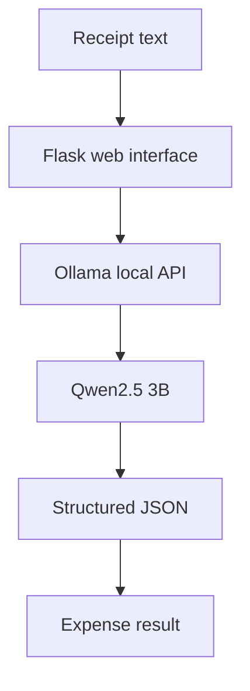

# 🧾 LocalReceipt AI

### Your receipts. Your AI. Your machine.

**A privacy-conscious expense classifier for freelancers, powered by open-weight AI and local inference.**

LocalReceipt AI transforms unstructured receipt text into structured expense records using **Qwen2.5 3B**, running locally through **Ollama**.

[](https://python.org)
[](https://flask.palletsprojects.com/)
[](https://ollama.com/)
[](https://ollama.com/library/qwen2.5)
[](LICENSE)

---

## ✨ The idea

Freelancers and independent professionals often waste time organizing receipts before bookkeeping. Meanwhile, sending financial information to a hosted AI service may not be desirable for every user.

**LocalReceipt AI explores a simpler alternative:** run an open-weight AI model on your own machine and turn receipt text into structured expense data.

- 🔒 **Privacy-conscious:** Local inference keeps receipt text on your machine when using Local AI Mode.
- 💸 **Cost-aware:** No per-request hosted AI API charges for local inference.
- 🧠 **Open-weight AI:** Powered by Qwen2.5 3B.
- 📴 **Offline-capable:** Classification can work without internet after the model is downloaded, provided the local services are running.
- 🛠️ **Customizable:** Change prompts, experiment with models, and adapt the workflow.

## 🚀 See how it works

### Example receipt

```text
Uber ride to client meeting,
₹420, 15 October 2026
```

### Structured expense output

```json
{
  "category": "Transport",
  "amount": 420,
  "currency": "INR",
  "date": "2026-10-15",
  "reason": "Uber ride to client meeting"
}
```

*Illustrative example of the expected output. Actual classifications are generated by the local model in Local AI Mode.*

## 🖥️ Demo

**Live interface:** [Add your Vercel URL here]

**Source code:** [Browse the GitHub repository](https://github.com/Kishan-shah12/localreceipt-ai)

The hosted Vercel version uses a clearly labelled **Demo Mode** with predefined sample data. It does not run Qwen or perform live AI inference.

For real classification, run the application locally with Ollama and Qwen2.5 3B.

> **Demo transparency:** Sample results are illustrative and are not generated by the model. The live AI functionality currently runs locally.

## 🧩 Features

| Feature | Description |
|---|---|
| Expense classification | Categorizes receipt text, such as transport |
| Amount extraction | Identifies the transaction amount |
| Currency identification | Represents currency using a code such as INR |
| Date normalization | Converts recognizable dates to ISO format |
| Structured output | Returns fields in JSON format |
| Local inference | Connects Flask to Ollama on your machine |
| Demo mode | Shows sample output without claiming live inference |

## 🏗️ How it's built



The local application sends receipt text from Flask to Ollama, which runs the Qwen2.5 3B model and returns a structured response.

The Vercel demo follows a separate path: it returns a fixed, clearly labelled example without calling an AI model.

## 🛠️ Tech stack

- **Language:** Python
- **Web framework:** Flask
- **Model runtime:** Ollama
- **AI model:** Qwen2.5 3B
- **Output format:** JSON
- **Hosting:** Vercel for the demo interface

## ⚡ Run locally

### Prerequisites

- Python 3
- [Ollama](https://ollama.com/download)
- A compatible Mac or computer with enough memory and storage for the model

### 1. Clone the repository

```bash
git clone https://github.com/Kishan-shah12/localreceipt-ai.git
cd localreceipt-ai
```

### 2. Create a virtual environment

```bash
python3 -m venv .venv
source .venv/bin/activate
```

On Windows:

```powershell
.venv\Scripts\activate
```

### 3. Install dependencies

```bash
pip install -r requirements.txt
```

### 4. Download the model

```bash
ollama pull qwen2.5:3b
```

### 5. Start the application

Make sure Ollama is running, then execute:

```bash
python app.py
```

### 6. Open the interface

Visit:

**http://127.0.0.1:5000**

Paste a receipt into the input field and select **Classify with Local AI**.

## 🔐 Privacy and security

LocalReceipt AI is designed to support local processing, but local inference is not a complete security guarantee.

- Local AI Mode sends receipt text to the Ollama service on the same machine.
- The Vercel Demo Mode uses predefined sample data and does not send submitted receipt text to a model.
- Avoid entering real financial information into public demonstrations.
- Review generated classifications before using them for accounting or tax reporting.

## 💡 Why open innovation?

This project explores how open-weight AI can make a focused utility more independent and customizable.

**Control over data:** Local inference offers an alternative to sending receipts to an external AI API.

**Control over cost:** Running an already-downloaded model avoids per-request hosted inference fees, although hardware and electricity are not free.

**Control over the model:** Developers can experiment with alternative models and customize prompts for specific workflows.

**Control over availability:** Local inference can continue offline after setup, without depending on an internet connection for every classification.

The key idea is simple: useful AI does not always need to run on someone else's server.

## 🗺️ Roadmap

- [x] Local AI inference using Ollama
- [x] Receipt text classification
- [x] Structured JSON output
- [x] Flask web interface
- [x] Clearly labelled hosted demo mode
- [ ] Receipt image and PDF extraction
- [ ] CSV expense export
- [ ] Duplicate receipt detection
- [ ] Expense summaries and reporting
- [ ] Accounting integrations

## ⚠️ Current limitations

- The current classifier accepts pasted receipt text rather than scanning receipt images.
- Model-generated information may be incomplete or incorrect.
- The Vercel demo does not perform live inference.
- This prototype is not a replacement for accounting software, professional bookkeeping, or tax advice.

## 🤝 Contributing

Suggestions, bug reports, and improvements are welcome.

1. Fork the repository.
2. Create a feature branch.
3. Make and test your changes.
4. Open a pull request describing the improvement.

## 👨‍💻 Author

**Kishan Shah**

[GitHub Profile](https://github.com/Kishan-shah12)

[Project Repository](https://github.com/Kishan-shah12/localreceipt-ai)

---

### Built for the Hacktoberfest Open-Source AI Challenge — Week 2: Side Hustle

*Small tools. Open models. More control over your data.*

